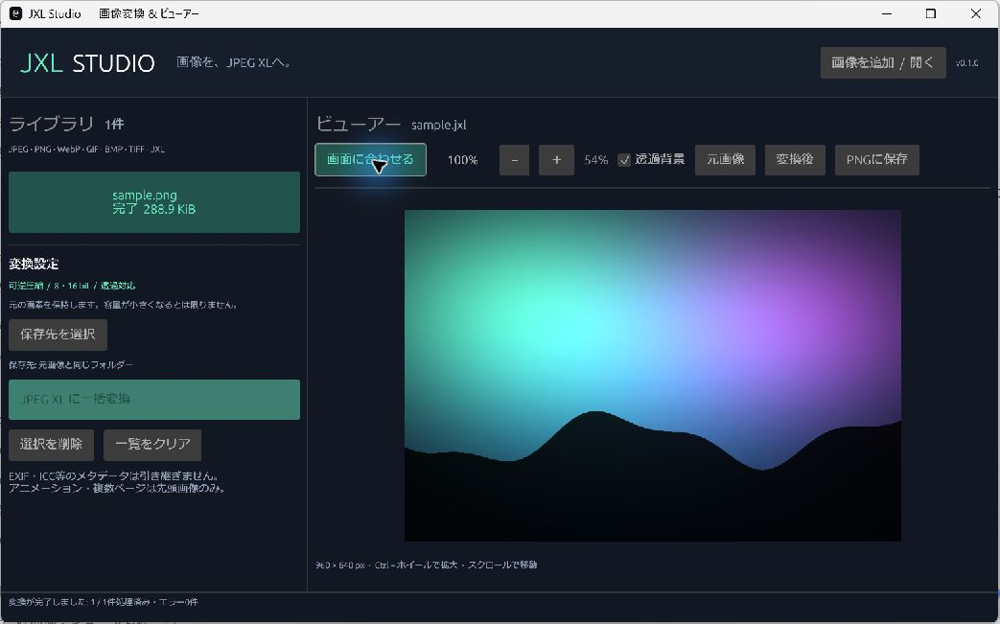

# JXL Studio

[日本語](README.md) | **English**

A Rust application for Windows and Android that converts images to lossless JPEG XL (`.jxl`) and displays them in a built-in viewer.
Batch-convert images and inspect the original and converted files in a Japanese or English interface.
Use the app's **日本語 / English** control to switch the display language.



## Download

Download the Windows x64 ZIP from [Releases](https://github.com/conmmitmentman/jxl-studio/releases), extract it, and run `jxl-studio.exe`.
You do not need to install Rust, Python, or external JPEG XL tools such as `cjxl`. The command-line application is `jxl-studio-cli.exe`.

**Android:** [Download the APK](https://github.com/conmmitmentman/jxl-studio/releases/download/android-v0.1.1/jxl-studio-android.apk). It supports Android 8.0 and later on arm64 / x86_64 devices.
The Android app provides the system file picker, lossless batch conversion, JXL viewing, pinch zoom, and JXL/PNG export.
See the [Android guide](android/README.en.md) for usage and limitations, or the [Android build guide](android/BUILDING.md) for building and signing.

## Features

- Lossless JPEG / PNG / WebP / GIF / BMP / TIFF → JPEG XL conversion
- Japanese and English display languages
- Preservation of 8-bit and 16-bit integer samples, grayscale/RGB, and alpha
- Multiple-file selection, drag and drop, batch conversion, and output-folder selection on desktop
- Direct JPEG XL viewing and switching between original and converted images
- Fit-to-window, 100% display, zoom, scrolling, and a transparency checkerboard
- PNG export of the displayed image; JXL files export as sRGB 16-bit PNG
- Background processing, progress reporting, and stopping after the current image finishes
- Numbered filenames for duplicate output names and saves that do not overwrite existing files
- Command-line conversion and PNG export

## Desktop usage

1. Choose **Add images / Open** or drop image files onto the window.
2. Optionally choose an output folder. By default, converted files are saved beside the original images.
3. Start batch JPEG XL conversion. Existing JXL files are opened for viewing.
4. Select an image in the library to display it. After conversion, use the original/converted controls to compare the files.

Press `Ctrl+O` to open images and `Ctrl+mouse wheel` to zoom. Scroll to move around large images.
Removing or clearing entries only removes them from the library; it does not delete files from disk.
You can also drop images onto the executable or supply their paths as command-line arguments.

```powershell
.\jxl-studio.exe "C:\Pictures\photo.jxl"
.\jxl-studio-cli.exe convert "input.png" "output.jxl"
.\jxl-studio-cli.exe export-png "output.jxl" "preview.png"
```

## Supported scope and limitations

- **Lossless means preserving decoded integer pixel samples.** The app does not perform JPEG bitstream recompression that can reconstruct the original JPEG file byte for byte, and it cannot recover quality already lost in a JPEG.
- Files do not always become smaller. Lossless JXL output can be larger than a JPEG or another source file. Lossy compression and quality adjustment are not supported.
- EXIF orientation is applied to the pixels. EXIF / ICC / XMP metadata is not copied to the output. Input samples are encoded as sRGB, so the app is unsuitable for preserving the color appearance of wide-gamut ICC images.
- GIF, APNG, animated WebP/JXL, and multipage TIFF use only the first displayed image. Animation playback and full-animation conversion are not supported.
- The app targets static images with 8-bit or 16-bit integer samples. HDR input, floating-point input, and HDR monitor output are not supported. JXL display and PNG export use SDR sRGB.
- On desktop, input files are limited to 512 MiB and images to 64 million pixels. JXL internal buffer allocations also have a 1 GiB limit; this is not a limit on the application's total memory use. Android has smaller input-file and batch limits listed in its guide.
- Desktop viewer textures are limited to 4096 pixels per side. Display dimensions and zoom percentages refer to the original image, but zooming into larger images enlarges the reduced preview. Conversion and PNG export retain the original resolution. Android previews are limited to 2048 pixels per side.
- Recursive folder import, OS file associations, and an installer are not provided.

## Development

Use Rust stable, version 1.88 or later. Windows x64 is the primary desktop target; the project also includes Linux build and test checks.

```sh
cargo run --release --bin jxl-studio
cargo test --locked --all-targets
cargo fmt --all -- --check
cargo clippy --locked --all-targets -- -D warnings
cargo build --locked --release --bins
```

Windows requires Visual Studio's **Desktop development with C++** workload and the Windows SDK.
On Ubuntu, install `libxkbcommon-dev libwayland-dev libgl1-mesa-dev`.
Japanese font fallback checks common locations for Meiryo/Yu Gothic on Windows, Hiragino on macOS, and Noto Sans CJK on Linux.
Install `fonts-noto-cjk` on Linux if you want Japanese text support.

Encoding uses [zune-jpegxl](https://docs.rs/zune-jpegxl/), decoding uses [jxl-oxide](https://docs.rs/jxl-oxide/),
and the desktop GUI uses [egui / eframe](https://github.com/emilk/egui). JPEG XL processing runs through Rust libraries without external codec commands.
Dependency versions are pinned in `Cargo.lock`.
The bundled encoder source includes fixes for one-pixel images and 16-bit alpha; see [vendor/zune-jpegxl/PATCHES.md](vendor/zune-jpegxl/PATCHES.md).

## Tests

Round-trip tests use independently implemented encoders and decoders to check exact pixel equality for 8/16-bit RGB, grayscale, transparency, odd dimensions, and multiple group sizes.
Tests also cover every advertised input format, EXIF orientation, Japanese paths, duplicate filenames, corrupt files, PNG export, and real CLI processes.
GitHub Actions runs Windows/Linux tests and static checks. Tags matching `v*` build the Windows distribution ZIP and SHA-256 checksum.
The Android workflow builds APKs and runs Android-specific JNI and emulator tests.

## License

MIT. See [THIRD_PARTY_NOTICES.md](THIRD_PARTY_NOTICES.md) for dependency notices.
